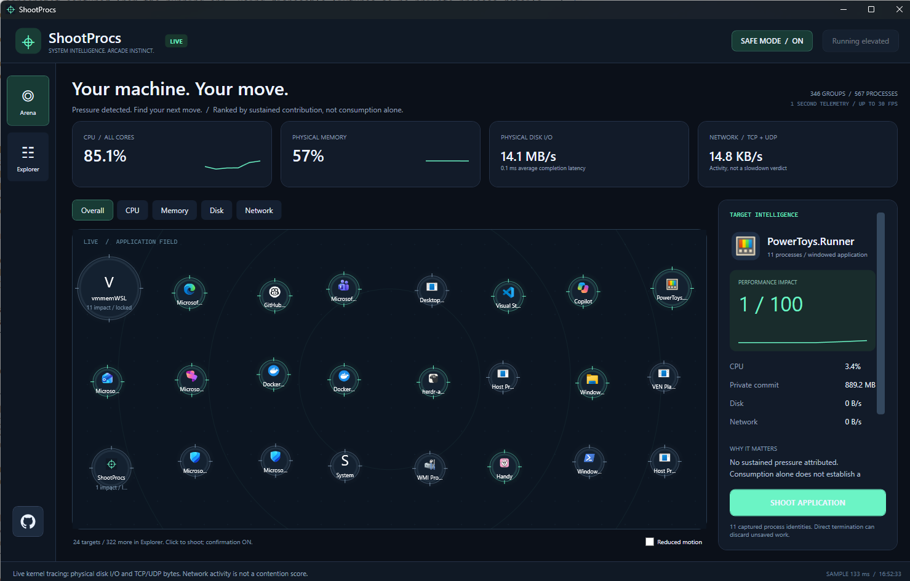

# ShootProcs

**Spot resource hogs. Take your shot.**

[](https://github.com/jsburckhardt/ShootProcs/actions/workflows/ci.yml)
[](https://github.com/jsburckhardt/ShootProcs/actions/workflows/codeql.yml)
[](LICENSE)

A native Windows 11 application that turns live application diagnostics into
an animated, interactive Arena, with a structured Process Explorer alongside it.
Built with .NET 10 and WPF. No browser, web server, or WebView UI.



*ShootProcs running elevated with live disk/network metrics and grouped
application targets. Screenshot supplied for publication by the project owner.
The GitHub logo in the lower-left sidebar opens this repository in your browser.*

## Install: download, run, done

**Windows 11 x64. No administrator account, SDK, or separate .NET installation
needed for normal use.**

1. [Download ShootProcs-Setup.exe](https://github.com/jsburckhardt/ShootProcs/releases/latest/download/ShootProcs-Setup.exe).
2. Run it and choose **Install**. Start-menu integration and Windows uninstall
   support are included; a desktop shortcut is optional.
3. Open ShootProcs. **Safe Mode is ON** by default.

Prefer no installer? [Download the portable ZIP](https://github.com/jsburckhardt/ShootProcs/releases/latest/download/ShootProcs-win-x64.zip),
extract **all** files, and open `ShootProcs.exe`.

The installer is per-user: `%LOCALAPPDATA%\Programs\ShootProcs`. It installs no
service, driver, browser runtime, scheduled task, or startup entry.
Builds are currently **unsigned**: Windows SmartScreen or organizational policy
may warn or block them. Use only official releases and verify the
[published SHA-256 checksums](https://github.com/jsburckhardt/ShootProcs/releases/latest/download/SHA256SUMS.txt);
do not disable Windows security tools. Checksums are integrity checks, not a
Windows publisher signature.

See [installation, updates, and removal](docs/installation.md).

## Admin is optional, not the default

Without admin, Arena and Explorer work with live CPU/private memory, grouping,
search, inspection, and termination of permitted applications you own.
It is **not the full feature set**: kernel disk/network metrics are unavailable,
and Windows can deny access to some processes.

For disk/network metrics, click **Enable tracing** and approve UAC. This restarts
the **entire application elevated**, not just a collector. It still protects
essential Windows processes, itself, and processes outside the allowed
owner/session. Safe Mode is a confirmation setting, **not a security sandbox**.
Direct termination can discard unsaved work in either mode.

Read [exact permissions and why they are needed](docs/permissions.md).

## Privacy

Monitoring stays on your PC. There are no analytics, accounts, remote servers,
or automatic uploads. Network monitoring counts TCP/UDP bytes; it does not
capture packet contents. Ordinary use does not save process inventories.
Developer verification explicitly writes local reports/screenshots, which may
contain process names and paths; review and redact them before sharing.

## Use

- **Arena:** Hover or Tab to an application to inspect it. Click, Space, or
  Enter shoots it. The scene shows up to 24 relevant groups; Explorer exposes
  the rest.
- **Overall / CPU / Memory / Disk / Network:** Switch what determines target
  size. Overall scores likely contribution to sustained system pressure; it
  does not accuse large applications on a healthy machine.
- **Safe Mode ON**, the default, asks before directly terminating the captured
  group. **OFF** immediately attempts direct termination. Both discard unsaved
  application work and retain system/self protection.
- **Explorer:** Search names, paths, or PIDs. Click column headings to sort.
  Expand `+` for individual processes; **End** targets only that process.
  Enable **Background** to include small and non-windowed groups.
- **Reduced motion:** Stops orbital movement. The initial setting respects the
  Windows client-area animation preference.
- **Enable tracing:** An explicit UAC action restarts ShootProcs elevated to
  attempt kernel disk and network collection. Normal launch is unelevated.

One target can represent multiple windows and instances from the same
installation. Separate paths, users/sessions, and reliably identifiable browser
profiles remain distinct. A shot is bounded to captured PID + creation-time
identities; it does not chase restarts or include later instances.

## Measurements, honestly

CPU is normalized across all logical processors. Application memory is
**private committed bytes**, not exclusive physical RAM. The system memory card
shows physical RAM pressure separately. Private commit avoids adding shared
working-set pages as if every application owned them.

Physical disk I/O, completion latency, and TCP/UDP bytes come from Windows
kernel ETW tracing when available. They are **Unavailable** without adequate
permissions or after trace event loss, never fabricated zeroes. Network activity
is not included in Overall without evidence of network contention. Kernel
I/O can be charged to System or lack a recoverable application owner.

Impact is an explainable heuristic, not proof of causation. See
[measurement decisions](docs/adrs/0002-measurements-and-pressure.md).

## Build and validate

### Quick commands with just

From the project directory:

```powershell
just run             # launch the existing portable build
just run 'artifacts\release-candidate' # launch a separately published build
just dev             # build and run from source
just build           # build, tests, formatting, portable app and ZIP
just test            # build, behavior tests and formatting
just verify          # also check Windows adapters and native UI
just package         # installer, ZIP, checksums and published-app verification
just test-installer  # isolated install/launch/uninstall check
just                 # list commands
```

`just run` requires a previous `just build`. Close the published app before
rebuilding or packaging so Windows can replace its executable. Normal launch
does not request admin; use **Enable tracing** inside the app for disk/network
metrics.

`just run` opens an existing binary; it does not rebuild source or update a
window already running. If you still see the old "Native Windows" sidebar label,
close that window and install the current release, use `just dev`, or launch
the folder from your latest `-PublishDirectory` build. Current builds show a
GitHub logo there instead.

If needed, install the optional command runner with
`winget install --id Casey.Just --exact --source winget`.
The PowerShell commands below also work without just.

Requires Windows x64 and a .NET 10 SDK. This workspace has a private SDK under
`.tools\dotnet`; `build.ps1` uses it when present, otherwise the SDK on PATH.
The selected SDK is recorded in `global.json`.

```powershell
.\build.ps1 -Verify -Installer
```

This builds Release, runs behavior tests and formatting verification, publishes
the self-contained executable, ZIP, no-admin installer, and checksums, runs
isolated Windows integration, then launches the **published application** for
native-UI acceptance. Installer compilation uses a version- and SHA-256-pinned
Inno Setup compiler installed privately under `.tools`; it needs no machine-wide tool
installation. Use of Inno Setup is subject to its own license.

```powershell
.\build.ps1 -NoPublish             # build, tests, formatting only
.\build.ps1 -NoPublish -Verify     # also exercise the development executable
.\tools\Test-Installer.ps1        # isolated install/launch/uninstall verification
.\build.ps1 -Installer -Verify -PublishDirectory artifacts\release-candidate
# Use a separate folder if an existing published app is running.
```

For development:

```powershell
.\.tools\dotnet\dotnet.exe run --project src\ShootProcs.App
```

If the SDK is missing, install the .NET 10 SDK using Microsoft's installer or
`winget install --id Microsoft.DotNet.SDK.10 --exact --source winget`.
If the pinned feature band is unavailable, install it or deliberately update
`global.json` to an installed .NET 10 feature band.

For a source checkout, use `dotnet run --project src\ShootProcs.App` if the SDK
is on PATH. The private `.tools` SDK is a local convenience and is not committed.

Validation creates and terminates **only its own disposable workers**, and
never your existing applications. Generated reports and screenshots live under
`artifacts\validation` and `artifacts\ui`.

Measure a normal minute-long animated session with
`.\tools\Measure-Performance.ps1`; startup and short post-interaction samples
should not be confused with warmed-up overhead.

## Documentation

- [Installation, updates, uninstall, and checksums](docs/installation.md)
- [Permissions, non-admin limitations, and privacy](docs/permissions.md)
- [Product contract](PRD.md)
- [Architecture and data flow](docs/architecture.md)
- [Components and public behavior](docs/components.md)
- [Architecture decision records](docs/adrs/README.md)
- [Validation evidence and limitations](docs/validation.md)
- [Security policy](SECURITY.md)
- [Release history](CHANGELOG.md)

The optional tray/floating Performance Monitor is intentionally deferred.

## Repository security and releases

C# CodeQL security-extended analysis runs on main pushes, pull requests, and
weekly. Dependency review checks PRs; Dependabot maintains NuGet dependencies
and pinned GitHub Actions. CI builds Windows binaries and exercises application
behavior and installer lifecycle. Version tags build release assets from a clean
checkout, check their hashes, then publish the installer, ZIP, and checksum file.
The README screenshot was explicitly supplied for publication. Local diagnostic
screenshots and process inventories are not automatically published; traces,
SDKs, and credentials remain excluded.

There is no automatic updater yet. Because releases include .NET, runtime
security updates require a new ShootProcs release. Windows Authenticode signing,
ARM64-native builds, Store/winget distribution, and the optional tray monitor
are not currently provided.

## Contributing

See [CONTRIBUTING.md](CONTRIBUTING.md) for product principles, safe disposable
testing, architecture documentation, and pull-request expectations.

## License

[MIT](LICENSE). Third-party software retains its own
[licenses and notices](THIRD-PARTY-NOTICES.md).
