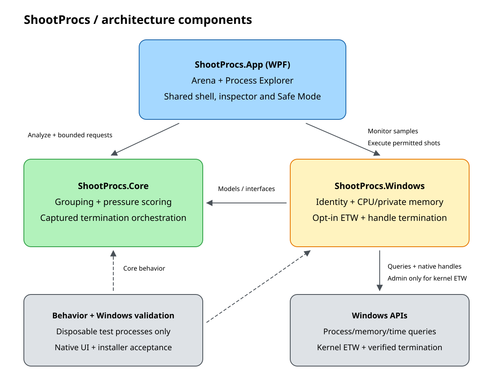
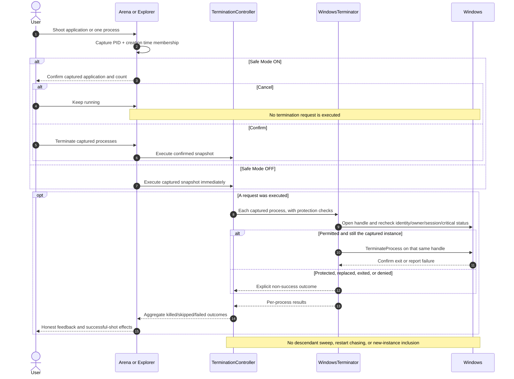

# Architecture

## Native application, shared semantics

ShootProcs has three production layers and two validation projects:

1. **Core** contains immutable observations, logical grouping, pressure
   diagnosis, stable Arena selection, formatting, and bounded termination
   orchestration. It has no Windows or UI dependency.
2. **Windows** owns native process discovery, identity, metrics, permission and
   protection checks, optional ETW sessions, and handle-based direct termination.
3. **App** is the WPF desktop shell. Arena and Process Explorer consume the
   same diagnosis and send captured requests through the same controller.

The dependency direction is App -> Windows -> Core. The test project references
Core; the Windows validation executable references Windows. No presentation
class makes its own independent process grouping or termination decision.



[Editable Excalidraw component diagram](diagrams/components.excalidraw).

## Live observation sequence

```mermaid
sequenceDiagram
    autonumber
    participant App as WPF background loop
    participant Monitor as WindowsMonitor
    participant ETW as TraceTelemetry
    participant OS as Windows APIs
    participant Core as DiagnosticEngine
    participant UI as Arena and Explorer
    App->>Monitor: Sample using actual elapsed time
    Monitor->>OS: Query identities, CPU times, memory and windows
    OS-->>Monitor: Permitted process and machine observations
    alt Elevated and kernel tracing available
        Monitor->>ETW: Drain disk/network events
        ETW-->>Monitor: Byte deltas, latency, attribution confidence
    else Unelevated or tracing failed
        Monitor->>Monitor: Leave disk/network metrics unavailable
    end
    Monitor-->>App: Immutable MonitorSnapshot
    App->>Core: Analyze snapshot
    Core-->>App: Grouping, pressure score and explanations
    App->>UI: Dispatch one shared Diagnosis
    Note over App,UI: Single sampling loop; approximately one-second cadence
```

## Observation pipeline

Once per approximately one second, a single background loop:

1. Takes a Tool Help process-parent snapshot and enumerates visible top-level
   windows once to identify windowed applications.
2. Enumerates processes and opens query/read handles where allowed.
3. Reads creation time and CPU time, private committed bytes, working set,
   owner, session, executable path, and optional browser profile arguments.
   Stable metadata is cached by PID plus creation time and removed on exit.
4. Drains optional kernel ETW disk/network observations for the elapsed interval.
   An interval with events predating the current process identity is not
   attributed to that replacement process.
5. Measures machine CPU time deltas and physical memory availability.
6. Passes one immutable `MonitorSnapshot` to the stateful `DiagnosticEngine`.
7. Delivers the resulting `Diagnosis` to the UI dispatcher.

Only one loop samples; overlapping timer callbacks are not possible. Elapsed
time is measured rather than assumed to be exactly one second. A slow sample
reduces cadence rather than spawning concurrent collectors.

First-sample process CPU is unavailable because a delta needs two observations.
Inaccessible or incomplete values remain nullable throughout aggregation and
presentation. A group with a missing member measurement does not masquerade
as a complete measured total.

## Identity and application boundaries

The execution identity is `(PID, creation FILETIME)`. The grouping identity
includes owner SID, session, canonical case-insensitive executable path, and
reliably observed profile arguments.

Observed ancestry can connect helpers in an installation to their root.
Embedded Edge WebView helpers can join their observed application host even
when the shared WebView runtime lives elsewhere; desktop/command shell
launchers are excluded from that special rule. A parent created after its
purported child is rejected as a recycled PID.

An application group spans instances from the same identity, not merely one
process tree. Parent traversal never crosses owner/session boundaries or
explicitly conflicting profile identities. Unknown executable/owner identities
stay isolated. Browser processes sharing an indistinguishable root cannot
always be divided into profiles; no such precision is claimed.

The representative icon and name come from the logical root where possible,
using executable version metadata and the Windows shell icon.

Shared interpreter/service hosts such as Node, Python, .NET, PowerShell,
RuntimeBroker, and standalone WebView roots do not merge independent jobs merely
because the runtime installation matches. Their observed tree root supplies
an additional job identity. A runtime child can join an observed windowed
application or editor host, but not a desktop/command/terminal launcher.

## Pressure diagnosis

Overall distinguishes resource consumption from evidence that the machine is
under pressure. The engine considers machine CPU load, physical RAM pressure,
and measured disk completion latency, then estimates each group's contribution.
Exponential smoothing with a five-second time constant dampens transient spikes.

Evidence channels combine as a bounded union:

`score = 100 * (1 - (1 - cpuEvidence) * (1 - memoryEvidence) * (1 - diskEvidence))`

This is not a sum of unrelated percentages or a probabilistic causal guarantee.
Memory attribution is especially approximate: private commit is a reproducible
ownership measure but is not physical residency. Each inspector explains this,
lists active pressure evidence, and reports incomplete telemetry.

Network is useful resource activity but is not scored as a slowdown without
reliable contention evidence. Exact thresholds and limitations are recorded in
[ADR 0002](adrs/0002-measurements-and-pressure.md).

## Presentation and interaction

WPF provides native controls, accessibility peers, vector drawing, frozen icon
images, and hardware-accelerated transforms. The Arena contains at most 24
button targets, not a visual object for every process.

Target selection has a replacement margin to avoid flicker. Size follows the
selected resource, using a square-root scale constrained by available cell
space. With no significant Overall impact, consumption determines selection
and geometry while the displayed impact score remains honest.

Orbital movement runs at at most approximately 30 frames/second using a bounded
dispatcher timer and render transforms, not repeated layout positioning. Static
field imagery and target textures are cached; unchanged displayed values do not
force repainting, and tiny diameter jitter is ignored. Hovered, focused, or
inspected targets remain pinned. Confirmation freezes the Arena. Hidden, frozen,
unloaded, and reduced-motion states stop the animation timer. Protected targets
still support inspection.

Explorer maintains stable row objects with property change notifications,
virtualized rows, live sorting/filtering, and expansion for member processes.
It does not replace the entire collection every second. CPU bars are one-way
bindings: monitoring never writes back into measurements.

The inspector and fixed action button are shared. Small non-windowed groups are
hidden by default in Explorer unless relevant by consumption; background mode
or an explicit search reveals them.

## Command pipeline



1. Capture the selected group's current process samples into an immutable action
   snapshot, or capture exactly one member for an individual action.
2. Reject protected targets in the presentation layer.
3. If Safe Mode is ON, show the application, count, and captured PIDs, and await
   confirmation. The pending membership is not refreshed.
4. `TerminationController` independently enforces confirmation and protection.
5. `WindowsTerminator` opens a handle to the captured PID and verifies creation
   time, critical status, owner, session, essential-process status, and self
   protection again.
6. Call `TerminateProcess` on that same verified handle and wait for confirmed
   exit. Do not enumerate descendants or retry against restarted instances.
7. Report per-process outcomes and partial failure. Only successful termination
   receives success effects; subsequent samples reveal measured resource changes
   and surviving or newly started instances.

Safe Mode controls confirmation, not protection. Both views use this pipeline.
The application manifest requests `asInvoker`. Explicit elevation starts a new
elevated instance; ordinary launch never prompts automatically.

## Lifecycle, overhead, and failure

Metadata and icons are cached, sampling is off the UI thread, and the Arena
visual count is bounded. Sampling duration is shown in the status bar; the
verification report records warmed-up overhead rather than asserting a universal
budget.

Expected process exits and access failures are handled per process. A failure
that stops the sampling loop is displayed instead of silently showing stale
data as live. Permission-limited metrics remain unavailable.

An elevated trace session has a unique name and is owned by this application.
Event loss disables attribution rather than producing apparently exact rates.
Normal close cancels and awaits polling so the collector disposes its ETW
session. No existing system-wide tracing session is deliberately stopped.

## Build and delivery

The Release build produces a self-contained, untrimmed Windows x64 single-file
executable. Native runtime libraries extract as required by .NET; there is no
separate runtime installation. A ZIP bundles the executable and launch notes.
An additional per-user installer places the same payload under local application
data, registers shortcuts/uninstall, and requires no administrator access.
Neither distribution is currently Windows-signed or Store-packaged.

`build.ps1 -Verify` runs the deterministic tests, Windows adapter integration,
format verification, publication, and acceptance on the published executable.
The source SDK, generated outputs, and local validation images are excluded
from source control.

Public delivery uses a fresh staging directory and an explicit payload allowlist.
The pinned Inno Setup compiler produces a no-admin installer, and release tags
build/test on Windows before publishing setup, portable ZIP, and checksums.
See [ADR 0005](adrs/0005-public-distribution.md).
